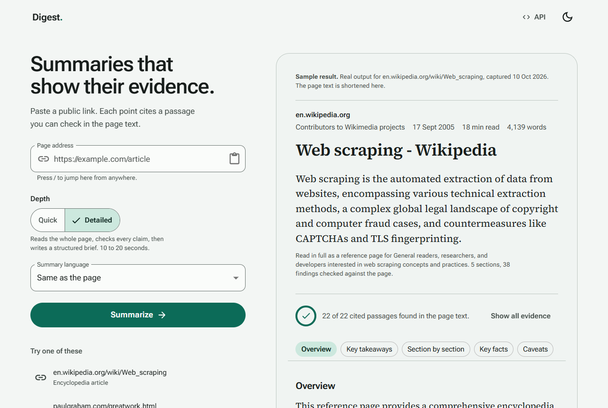
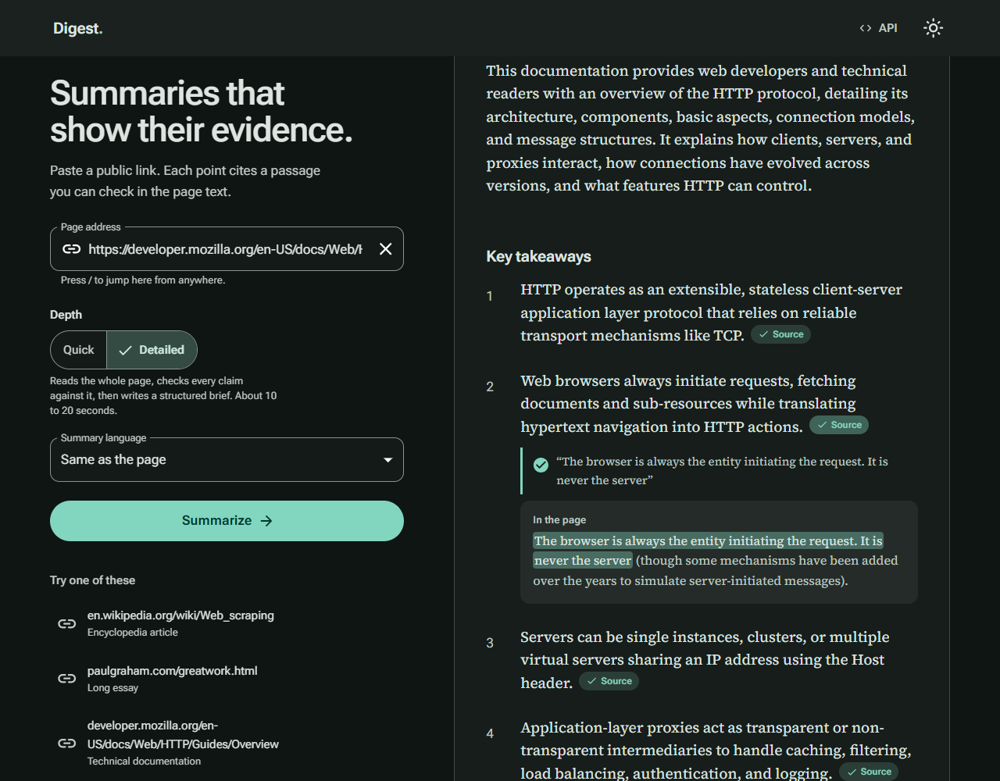
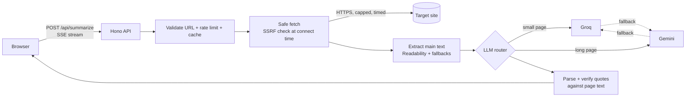

# Digest

Paste a public link and get a structured summary where **every point cites a passage you can check in the page text**.

Digest fetches the page safely, extracts the main text, has a free AI model (Google Gemini, with Groq as backup) read it, and then verifies on the server that each cited quote really appears in the page. Evidence that cannot be found is labelled as such rather than presented as fact.

**Live demo: <https://ai-web-scraper-gilt.vercel.app>** &nbsp;|&nbsp; [API description](https://ai-web-scraper-gilt.vercel.app/api/openapi.json) &nbsp;|&nbsp; [Health check](https://ai-web-scraper-gilt.vercel.app/api/health)

|                                                             |                                                                |
| ----------------------------------------------------------- | -------------------------------------------------------------- |
|  |  |

_Screenshots are real output from the running app (the first screen shows a captured sample)._

**Stack:** TypeScript end to end. React 19 and Vite frontend with Material UI (a custom Material 3 theme; Roboto Flex and Source Serif 4 from Google Fonts), a Hono API that runs as a Vercel Function, and shared TypeScript contracts between the two.

## Assignment brief and where it is implemented

| Requirement                                          | Implementation                                                                          |
| ---------------------------------------------------- | --------------------------------------------------------------------------------------- |
| Input field and a "Summarize" button                 | `apps/web`: address field, Enter or button                                              |
| Backend endpoint that receives the URL               | `POST /api/summarize` in `apps/api`                                                     |
| Scrape the main text of the page                     | `apps/api/src/pipeline`: SSRF-safe fetch, Mozilla Readability extraction with fallbacks |
| Summarize with a free AI API                         | Google Gemini (primary) and Groq (backup), both on free tiers                           |
| Show the summary with a "Loading..." state           | Streaming result; "Loading…" with progress steps driven by real server events           |
| README: how to run both halves and where `.env` goes | [Run it locally](#run-it-locally) and [Where the AI key goes](#where-the-ai-key-goes)   |
| Public repository                                    | <https://github.com/SanamBhanuPrakash/AI-Web-Scraper>                                   |
| Deployed live link                                   | <https://ai-web-scraper-gilt.vercel.app> ([how it is deployed](#deployment))            |

## Features

- **Detailed briefs (the default).** The page is read in full first (long pages are split and read in parallel); the model writes structured notes; code checks every quote and figure in those notes against the page. A second pass writes the brief from the verified notes only: a one-sentence answer, an overview, numbered takeaways, a walk through each section of the page, key facts, caveats and next steps. Choose **Quick** for a single fast pass with a length and format.
- **Evidence you can check.** Each point carries a quote that the server has verified against the page text. A small **Source** marker at the end of a point opens the quote and shows it highlighted in its real paragraph. The full extracted page text is one click away.
- **Secure by design.** A service that fetches arbitrary URLs is an SSRF target, so the fetcher validates the address _at connection time_, re-validates every redirect, caps size and time, and defuses compressed "bombs". See [docs/security.md](docs/security.md).
- **Clear error messages.** JavaScript-only pages, PDFs, 404s, blocked sites, cookie and sign-in walls, bot-challenge pages, timeouts and AI quota limits each get a specific message and a next step.
- **Robust page handling.** Follows one validated `<meta refresh>` hop, recognises sites that cannot be read without an app or an account before making a request, strips footnote markers, and removes `<think>` blocks that reasoning models emit.
- **Your language.** Choose the summary language (Hindi, Spanish, French, Japanese and more); quotes stay in the page's own language so they stay checkable. Right-to-left text renders correctly.
- **Fast and resilient.** Short pages go to Groq first (about 1 second end to end), long pages to Gemini for its larger context; the result streams as it is written. Provider fallback with a circuit breaker, per-client rate limits, and response caching.
- **Pleasant to use.** Navigation bar for long briefs, Copy as Markdown and Download `.md`, back-to-top button, your depth, length, format and language remembered for next time, paste a link anywhere on the page, `Esc` to cancel, `/` to jump to the field, `?url=` links that pre-fill the form, history kept in your browser, light and dark themes, and a print layout.
- **Accessible.** Keyboard operable, screen-reader announcements, WCAG 2.2 AA verified by automated audits in both themes, reduced-motion support.
- **API-first.** `/api/openapi.json`, and the UI shows the exact `curl` for the request it just made.

## Run it locally

**Requirements:** Node.js 22 or newer (24 recommended) and npm. No database or other services are needed.

```bash
git clone https://github.com/SanamBhanuPrakash/AI-Web-Scraper.git
cd AI-Web-Scraper
npm install
cp .env.example .env          # Windows PowerShell: Copy-Item .env.example .env
```

### Where the AI key goes

Open the **`.env` file in the repository root** (the folder that contains `package.json`) and paste a free key:

```env
GEMINI_API_KEY=<paste your key>     # free, no card: https://aistudio.google.com/apikey
GROQ_API_KEY=<paste your key>       # optional backup, free: https://console.groq.com/keys
```

One key is enough. Only the API reads `.env`; the frontend never sees secrets. `.env` is git-ignored, so it is never committed.

### Start the backend and the frontend

```bash
npm run dev
```

This starts the API on <http://localhost:8787> and the frontend on <http://localhost:5173> (open this one). The frontend proxies `/api` to the API.

**No key yet?** `npm run dev` automatically starts the API in offline demo mode (a simple extractive summarizer), so the whole product can be tried in a minute. Add a key later for real AI summaries.

To run the two halves separately, in two terminals:

```bash
npm run dev:api     # backend  : http://localhost:8787
npm run dev:web     # frontend : http://localhost:5173
```

Check that the backend is up and which providers it found:

```bash
curl http://localhost:8787/api/health
```

### Use the API directly

```bash
curl -X POST http://localhost:8787/api/summarize \
  -H 'content-type: application/json' \
  -d '{"url":"https://en.wikipedia.org/wiki/Web_scraping","length":"short"}'
```

Add `-H 'accept: text/event-stream'` to receive Server-Sent Events as the summary is written. The API default is `length: medium`; send `"length":"detailed"` for the read-then-write brief (the web app uses it by default). The full contract is at `/api/openapi.json`.

### Troubleshooting a local setup

| Symptom                                         | Cause and fix                                                                                                                       |
| ----------------------------------------------- | ----------------------------------------------------------------------------------------------------------------------------------- |
| `npm install` or the build complains about Node | Use Node.js 22 or newer: `node --version`.                                                                                          |
| The page loads but summaries are very basic     | No key was found, so the API is in offline demo mode. Add `GEMINI_API_KEY` or `GROQ_API_KEY` to `.env`, then restart `npm run dev`. |
| `/api/health` shows `"mock":true`               | Same as above, or `DIGEST_MOCK_LLM=1` is set in `.env`.                                                                             |
| "AI capacity reached for now"                   | The free quota of the provider was used up for the moment. Wait the time shown, or add the other provider's key.                    |
| Port 8787 or 5173 already in use                | Stop the other process, or set `PORT` in `.env` for the API.                                                                        |
| A site returns "blocked" or "needs JavaScript"  | The site refuses automated requests or builds its content in the browser. Try a different page.                                     |

## Configuration

All settings are environment variables in `.env` (see [.env.example](.env.example), which documents each one). The ones you are most likely to touch:

| Variable                           | Default       | What it does                                        |
| ---------------------------------- | ------------- | --------------------------------------------------- |
| `GEMINI_API_KEY`, `GROQ_API_KEY`   | none          | At least one is needed unless `DIGEST_MOCK_LLM=1`   |
| `GEMINI_MODEL`, `GROQ_MODEL`       | verified live | Model ids (providers rename and retire models)      |
| `LLM_ROUTING`                      | `size-aware`  | `ordered` keeps the configured order instead        |
| `RATE_LIMIT_PER_MIN`               | `6`           | Requests per client per minute                      |
| `UPSTASH_REDIS_REST_URL`, `_TOKEN` | none          | Optional shared cache and rate limit (free Upstash) |

## How it works



1. **Validate.** The address is normalised and checked against a strict policy (http/https only, ports 80/443, no credentials, no private or internal names or IPs). The request is rate limited per client and looked up in the cache.
2. **Fetch.** DNS is resolved _inside the socket's own lookup_, rejecting any private address, so the address that passes the check is the one connected to (no DNS-rebinding window). Redirects are followed manually and re-checked at every hop. Size, time and decompressed size are capped.
3. **Extract.** Text is decoded with the right charset, the main article is found with Mozilla Readability, boilerplate and footnote markers are removed, and invisible characters (a prompt-injection vector) are stripped. Pages that ship their text as JSON-LD or app state are recovered; JavaScript-only shells are reported with a clear message.
4. **Summarize.** The page is fenced as untrusted data in the prompt. The router picks a provider by page size, falls back before the first token if one is slow or out of quota (never mid-answer), and streams text.
   - _Quick_ (`short`, `medium`, `long`): one pass.
   - _Detailed_: **read, then write.** Pass 1 reads the whole page (parts of at most 120k characters, in parallel) and returns JSON notes: page type, purpose, audience, thesis, an outline of the page's sections, and 12 to 40 findings, each with an importance score and an exact quote. Code verifies every quote and figure against the page and drops what it cannot confirm. Pass 2 sees only the verified notes, never the page, and writes the brief citing note ids, so the evidence shown for a line is a quote that was already checked. If the notes are unusable it falls back to a single long pass.
5. **Verify.** The stream is parsed into a short summary and points with quotes. Each quote is checked against the page text (verbatim, near-verbatim, or in order with short asides skipped). Unverifiable points are labelled. Numbers in the summary that the page never states are flagged on that point.

More detail: [architecture](docs/architecture.md), [architecture decisions](docs/decisions.md), [security model](docs/security.md), [operations runbook](docs/runbook.md), [deployment guide](docs/deployment.md), [visual system](DESIGN.md), and the original [design plan](plan.md).

## Project layout

```
apps/api        Hono backend: pipeline/ (fetch, extract), llm/ (providers, router, grounding), routes/, lib/
apps/web        React + Vite + Material UI frontend (custom Material 3 theme)
packages/shared Error codes and request/response types used by both sides
api/            Vercel Function entry (mounts the same Hono app)
docs/           Architecture, decisions, security model, runbook, deployment guide, screenshots
scripts/        Dev launcher, hygiene and secret scans, burst test
DESIGN.md       Visual system and the rules the UI is reviewed against
```

## Quality and testing

```bash
npm run check     # hygiene + secret scan, ESLint, strict TypeScript, all unit and integration tests
npm run e2e       # real-browser tests (Playwright): full flows, accessibility audits (axe), strict CSP
```

For the browser tests, install Chromium once with `npx playwright install chromium`, or reuse an installed browser: `PW_CHANNEL=msedge npm run e2e` (or `chrome`).

544 automated tests:

- **Backend (444):** a table of 40+ SSRF attack addresses plus property-based tests against an independent oracle; hostile local servers (slow drip, endless streams, gzip and brotli bombs, redirect loops and redirects into private space, DNS rebinding); extraction on realistic pages including JavaScript shells; provider adapters against fake servers; router fallback and circuit breaker; prompt-injection and XSS cases; rate limiting, caching and end-to-end error mapping; the read-then-write pipeline (note parsing, verification, merging, the brief parser, fallback); and regression tests for every confirmed finding of an independent security review.
- **Frontend (69):** the whole user flow with a controllable fake stream, validation, cancel, retry countdown, history, remembered choices, keyboard shortcuts, theme.
- **Browser (31):** the same flows in a real browser against the real API; WCAG 2.2 AA audits in light and dark for the first screen, a fully expanded result and the error state; no horizontal scroll from 320 to 1280 px; worst-case data (a 200 character unbroken title, a 100k word page); and zero Content-Security-Policy violations.

Load check (mock summarizer, `scripts/burst.mjs`): 200 full-pipeline requests at 50 concurrency all succeeded (p95 about 0.8 s); cache hits answer in about 25 ms; beyond the rate limit clients receive `429` with `Retry-After`.

Summary quality is measured, not guessed: `npm run eval -w @digest/api` runs 8 real pages through the live pipeline and reports filler openers, vague wording, concrete-detail share, repetition, page coverage and quote grounding (see [decision 16](docs/decisions.md)). A live smoke test against the real internet and AI (needs keys): `npm run smoke -w @digest/api -- https://en.wikipedia.org/wiki/Web_scraping`.

## Deployment

The app is deployed on Vercel's free Hobby plan: **<https://ai-web-scraper-gilt.vercel.app>**. One Vercel project serves both the static frontend and the API function, and every push to `main` redeploys it. There is no cold-start sleep and no card is needed.

To deploy your own copy (the complete guide, with checks and troubleshooting, is [docs/deployment.md](docs/deployment.md)):

1. Push the repository to GitHub.
2. In Vercel choose **Add New, Project** and import it.
   - Set **Application Preset** to **Other**. Vercel may suggest "Services" because the repository contains two apps; do not use it, and do not import `api` or `web` as separate projects.
   - Leave **Root Directory** as the repository root. The build settings come from [vercel.json](vercel.json): build `npm run build`, output `apps/web/dist`, function `api/[...path].ts`.
3. Under **Environment Variables** add `GEMINI_API_KEY` (and optionally `GROQ_API_KEY`) for Production and Preview. Optionally add a free [Upstash Redis](https://upstash.com) database via `UPSTASH_REDIS_REST_URL` and `UPSTASH_REDIS_REST_TOKEN` so the rate limit and cache are shared across serverless instances.
4. Deploy, then open `https://<your-app>.vercel.app/api/health`. It lists which AI providers are configured.

From the command line instead: `npx vercel` (preview) and `npx vercel --prod`.

Security headers (strict Content-Security-Policy, nosniff, referrer and permissions policies, HSTS) are defined once in `vercel.json` and are also applied during the browser tests. Scripts are limited to `'self'`; styles allow inline because Material UI injects them at runtime. Requests abandoned by the client are cancelled (`supportsCancellation`) so they stop using AI quota.

## Security and privacy

- Page text is sent to Google Gemini or Groq to write the summary; the interface says so.
- Nothing else is stored on the server. Recent summaries and your preferences live in your browser only. Logs record the target host, never the full URL, page text or keys.
- API keys exist only in server-side environment variables (`.env` locally, Vercel settings in production); they never reach the browser or the repository.
- The fetcher identifies itself as `DigestBot` and makes one request per user action.
- Full threat model and mitigations: [docs/security.md](docs/security.md).

## License

MIT, see [LICENSE](LICENSE).
