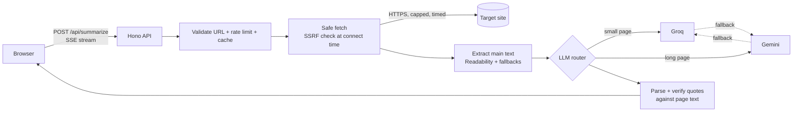

# Digest

Paste a public link and get a short summary where **every point cites a passage you can check in the page text**.

Digest fetches the page safely, extracts the main text, asks a free AI model (Google Gemini, with Groq as backup) for a summary, and then verifies on the server that each cited quote really appears in the page. Points whose quote cannot be found are marked "Not found in the page" instead of being presented as fact.

|                                                             |                                                                |
| ----------------------------------------------------------- | -------------------------------------------------------------- |
|  |  |

_Screenshots are real output from the running app (the first screen shows a captured sample)._

- **Live demo:** _(see [Deploy](https://ai-web-scraper-gilt.vercel.app/))_
- **Stack:** TypeScript end to end. React + Vite frontend with **Material UI** (custom Material 3 theme, Roboto Flex and Source Serif 4 from Google Fonts), Hono API (runs as a Vercel Function), shared TypeScript contracts.

## What you get

| Brief requirement                                        | Where                                                             |
| -------------------------------------------------------- | ----------------------------------------------------------------- |
| Input field and a "Summarize" button                     | `apps/web` (address field, Enter or button)                       |
| API endpoint that receives the URL                       | `POST /api/summarize` in `apps/api`                               |
| Scrape the main text of the page                         | `apps/api/src/pipeline` (SSRF-safe fetch, Readability extraction) |
| Free AI API for the summary                              | Gemini (primary) and Groq (fallback), both free tiers             |
| Show the summary with a "Loading..." state               | Streaming result, "Loading…" with real progress steps             |
| README with how to run both halves and where `.env` goes | this file                                                         |
| Deployed live link                                       | [Deploy](#deploy-to-vercel-free)                                  |

Beyond the brief:

- **Detailed briefs (the default).** The page is read in full first (long pages are split and read in parallel), the model writes structured notes, and code checks every quote and figure in those notes against the page. A second pass then writes the brief from the verified notes only: a one-sentence answer, an overview, numbered takeaways, a walk through each section of the page, key facts, caveats and next steps. Choose **Quick** for a single fast pass with a length and format. About 10 to 20 seconds.
- **Evidence you can check.** Each point carries a quote; the server verifies it against the page text. Click a quote to see the passage in its real paragraph, highlighted. The full extracted page text is one click away.
- **Safe by construction.** A "fetch any URL" service is a classic SSRF target, so the fetcher validates the address _at connection time_, re-validates every redirect, caps size and time, and defuses compressed "bombs". See [docs/security.md](docs/security.md).
- **Honest failures.** JavaScript-only pages, PDFs, 404s, blocked sites, cookie and sign-in walls, bot-challenge pages, soft 404s, timeouts and AI quota limits each get a specific message and a next step, never a stack trace.
- **Real-world page handling.** Follows one validated `<meta refresh>` hop, refuses sites that can never be read (YouTube, X, Instagram and similar) before making a request, strips footnote markers, and removes `<think>` blocks that reasoning models emit.
- **Your language.** Choose the summary language (Hindi, Spanish, French, Japanese and more); quotes stay in the page's own language so they stay checkable. Right-to-left text renders correctly.
- **Fast.** Short pages go to Groq first (about 1 second end to end); long pages go to Gemini first for its larger context. The result streams in point by point.
- **Resilient.** Provider fallback with a circuit breaker, per-client rate limits, response caching, partial-extraction and truncation notices.
- **Pleasant to use.** A back-to-top button that appears once you have scrolled about a third of a screen, your depth, length, format and language remembered for next time, paste a link anywhere on the page, Esc to cancel, `/` to jump to the field, paste or clear the address in one click, `?url=` links that pre-fill the form, one-click share, history in your browser, light and dark themes, a print layout for the summary.
- **Accessible.** Keyboard operable, screen-reader announcements, WCAG 2.2 AA verified by automated audits in both themes, reduced-motion support.
- **API-first.** `/api/openapi.json`, and the UI shows the exact `curl` for what it just did.

## Run it locally

**Requirements:** Node.js 22 or newer (24 recommended) and npm.

```bash
git clone <your-repo-url> digest
cd digest
npm install
cp .env.example .env          # Windows PowerShell: Copy-Item .env.example .env
```

### Where the AI key goes

Open the **`.env` file in the repository root** (the folder that contains `package.json`) and paste a free key:

```env
GEMINI_API_KEY=<paste your key>     # free, no card: https://aistudio.google.com/apikey
GROQ_API_KEY=<paste your key>       # optional backup, free: https://console.groq.com/keys
```

One key is enough. Only the API reads `.env`; the frontend never sees secrets. `.env` is git-ignored (never commit it).

### Start both the backend and the frontend

```bash
npm run dev
```

This starts the API on <http://localhost:8787> and the frontend on <http://localhost:5173> (open this one). The frontend proxies `/api` to the API.

**No key yet?** `npm run dev` automatically starts the API in offline demo mode (a simple extractive summarizer), so you can try the whole product in a minute. Add a key later for real AI summaries.

To run the two halves separately, in two terminals:

```bash
npm run dev:api     # backend  : http://localhost:8787
npm run dev:web     # frontend : http://localhost:5173
```

Quick check that the backend is up and which providers it sees:

```bash
curl http://localhost:8787/api/health
```

### Try the API directly

```bash
curl -X POST http://localhost:8787/api/summarize \
  -H 'content-type: application/json' \
  -d '{"url":"https://en.wikipedia.org/wiki/Web_scraping","length":"short"}'
```

Add `-H 'accept: text/event-stream'` to receive Server-Sent Events as the summary is written. The API default is `length: medium`; send `"length":"detailed"` for the read-then-write brief (the web app uses it by default). The full contract is at `/api/openapi.json`.

## Configuration

All settings are environment variables in `.env` (see [.env.example](.env.example), which documents each one). The ones you are most likely to touch:

| Variable                           | Default       | What it does                                        |
| ---------------------------------- | ------------- | --------------------------------------------------- |
| `GEMINI_API_KEY`, `GROQ_API_KEY`   | none          | At least one is needed unless `DIGEST_MOCK_LLM=1`   |
| `GEMINI_MODEL`, `GROQ_MODEL`       | verified live | Model ids (providers rename and retire models)      |
| `LLM_ROUTING`                      | `size-aware`  | `ordered` keeps the configured order instead        |
| `RATE_LIMIT_PER_MIN`               | `6`           | Requests per client per minute                      |
| `UPSTASH_REDIS_REST_URL`, `_TOKEN` | none          | Optional shared cache and rate limit (free Upstash) |

## How it works



1. **Validate.** The address is normalised and checked against a strict policy (http/https only, ports 80/443, no credentials, no private or internal names or IPs). The request is rate limited per client and looked up in the cache.
2. **Fetch.** DNS is resolved _inside the socket's own lookup_, rejecting any private address, so the address that passes the check is the one connected to (no DNS-rebinding window). Redirects are followed manually and re-checked at every hop. Size, time and decompressed size are capped.
3. **Extract.** Text is decoded with the right charset, the main article is found with Mozilla Readability, boilerplate and footnote markers are removed, invisible characters (a prompt-injection vector) are stripped. Pages that ship their text as JSON-LD or app state are salvaged; JavaScript-only shells are reported honestly.
4. **Summarize.** The page is fenced as untrusted data in the prompt. The router picks a provider by page size, falls back before the first token if one is slow or out of quota (never mid-answer), and streams text.
   - _Quick_ (`short`, `medium`, `long`): one pass.
   - _Detailed_: **read, then write.** Pass 1 reads the whole page (parts of at most 120k characters, in parallel) and returns JSON notes: page type, purpose, audience, thesis, an outline of the page's sections, and 12 to 40 findings, each with an importance score and an exact quote. Code verifies every quote and figure against the page and drops what it cannot confirm. Pass 2 sees only the verified notes, never the page, and writes the brief citing note ids, so the evidence shown for a line is a quote that was already checked. If the notes are unusable it falls back to a single long pass.
5. **Verify.** The stream is parsed into a short summary and points with quotes. Each quote is checked against the page text (verbatim, near-verbatim, or in order with short asides skipped). Unverifiable points are labelled, not hidden. Numbers in the summary that the page never states are flagged on that point.

More detail: [docs/architecture.md](docs/architecture.md), decisions and trade-offs: [docs/decisions.md](docs/decisions.md), threat model: [docs/security.md](docs/security.md), operations: [docs/runbook.md](docs/runbook.md), visual system: [DESIGN.md](DESIGN.md), the original design plan: [plan.md](plan.md).

## Project layout

```
apps/api        Hono backend: pipeline/ (fetch, extract), llm/ (providers, router, grounding), routes/, lib/
apps/web        React + Vite + Material UI frontend (custom Material 3 theme)
packages/shared Error codes and request/response types used by both sides
api/            Vercel Function entry (mounts the same Hono app)
docs/           Architecture, decisions, security model, runbook, screenshots
scripts/        Dev launcher, hygiene and secret scans, burst test
DESIGN.md       Visual system and the rules the UI is reviewed against
```

## Quality gates

```bash
npm run check     # hygiene + secret scan, ESLint, strict TypeScript, all unit/integration tests
npm run e2e       # real-browser tests (Playwright): full flows, accessibility audits (axe), strict CSP
```

For the browser tests, install Chromium once with `npx playwright install chromium`, or reuse an installed browser: `PW_CHANNEL=msedge npm run e2e` (or `chrome`).

What is covered (544 automated tests at the time of writing):

- **Backend (444):** a table of 40+ SSRF attack addresses plus property-based tests against an independent oracle, hostile local servers (slow drip, endless streams, gzip and brotli bombs, redirect loops and redirects into private space, DNS rebinding), extraction on realistic pages including JavaScript shells, provider adapters against fake servers, router fallback and circuit breaker, prompt-injection and XSS cases, rate limiting, caching, and error mapping end to end, and regression tests for every confirmed finding of an independent security review (quadratic-time regexes on hostile HTML, altered numbers and negations in quotes, redirect and refresh edge cases).
- **Frontend (69):** the whole user flow with a controllable fake stream, validation, cancel, retry countdown, history, keyboard shortcuts, theme.
- **Browser (31):** the same flows in a real browser against the real API, WCAG 2.2 AA audits in light and dark for the first screen, a fully expanded result and the error state, no horizontal scroll from 320 to 1280 px, worst-case data (a 200 character unbroken title, a 100k word page), and zero Content-Security-Policy violations.

Load check (mock summarizer, `scripts/burst.mjs`): 200 full-pipeline requests at 50 concurrency all succeeded (p95 about 0.8 s); cache hits answer in about 25 ms; beyond the rate limit clients get `429` with `Retry-After`.

Live smoke test against the real internet and real AI (needs keys): `npm run smoke -w @digest/api -- https://en.wikipedia.org/wiki/Web_scraping`

## Deploy to Vercel (free)

**The complete step-by-step guide, with checks and troubleshooting, is [docs/deployment.md](docs/deployment.md).** The short version:

The Hobby plan is enough: functions can run up to 5 minutes (Digest caps requests at 50 s), there is no cold-start sleep like free Render, and no card is needed.

1. Push the repository to GitHub.
2. In Vercel choose **Add New Project** and import it. Leave **Root Directory** as the repository root. The build settings come from [vercel.json](vercel.json) (build `npm run build`, output `apps/web/dist`, function `api/[...path].ts`).
3. Under **Settings, Environment Variables** add `GEMINI_API_KEY` (and optionally `GROQ_API_KEY`). Optional but recommended: a free [Upstash Redis](https://upstash.com) database, then add `UPSTASH_REDIS_REST_URL` and `UPSTASH_REDIS_REST_TOKEN` so the rate limit and cache are shared across serverless instances.
4. Deploy, then open `https://<your-app>.vercel.app/api/health`. It lists which providers are configured.

Alternatively from your machine: `npx vercel` (preview) and `npx vercel --prod`.

Security headers (strict Content-Security-Policy, nosniff, referrer and permissions policies) are defined once in `vercel.json` and applied to the browser tests as well. Scripts are limited to `'self'`; styles allow inline because Material UI injects them at runtime. Requests abandoned by the client are cancelled (`supportsCancellation`) so they stop spending AI quota.

## Limits and honest trade-offs

- **JavaScript-only sites** (the page is an empty shell that builds itself in the browser) cannot be read without a headless browser, which the brief excludes. Digest detects this, tries to salvage embedded data, and says so clearly.
- **Detailed mode makes two model calls** (more for very long pages) and takes 10 to 20 seconds, so it spends the free quota faster than Quick. It falls back to a single long pass if the notes are unusable; Quick stays available for speed.
- **Free-tier quotas** are real and change. Models are configurable, quotas are never hard-coded, and when both providers are exhausted the UI says so with a wait time instead of failing.
- **Rate limiting on serverless** is only best-effort per instance unless you add the optional Upstash database (a few clicks, free).
- **Summary quality is measured.** `npm run eval -w @digest/api` runs 8 real pages through the live pipeline and reports filler openers, vague wording, concrete-detail share, repetition and quote grounding (see decision 16). Numbers written in a summary that the page never states are flagged on that point.
- **Verification proves a quote is in the page, not that the point is true.** It makes fabricated evidence detectable, which is the failure that matters most for summaries.
- **Privacy.** The text of submitted pages is sent to Google or Groq to write the summary (stated in the UI). Nothing else is stored server-side; recent summaries live in the browser only. Logs record the host, not the full URL or page text.
- **robots.txt** is not enforced for a single, user-initiated fetch (the same stance as link-preview services); the fetcher identifies itself honestly as `DigestBot`.

## License

MIT, see [LICENSE](LICENSE).
