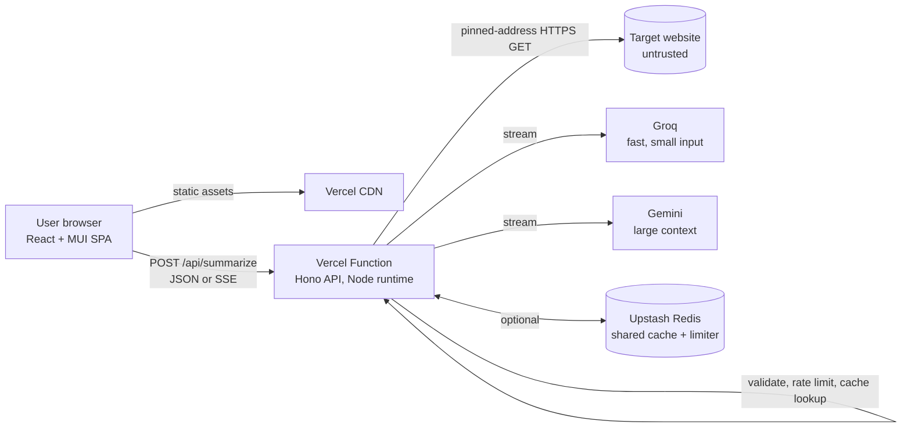
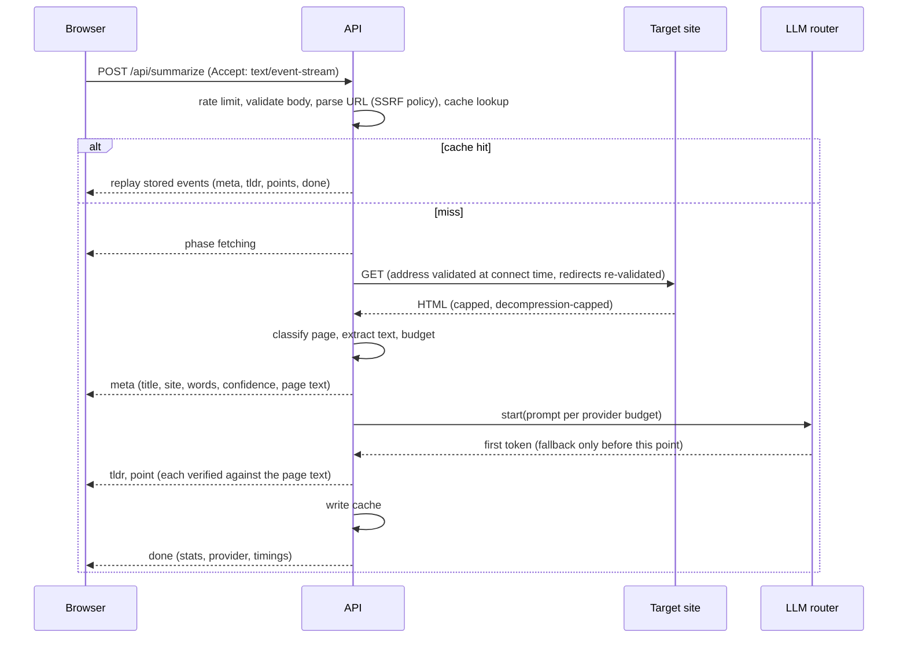
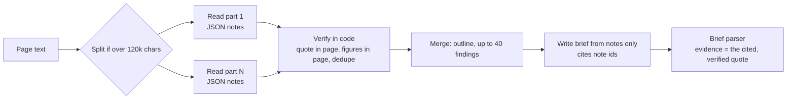

# Architecture

## 1. Context

One Vercel project serves the static frontend and the API from the same origin (no CORS). The API is stateless: any instance can serve any request. Redis is optional and only makes the cache and the rate limit global.

**Trust boundaries:** browser (untrusted client), target website (hostile content, hostile DNS, hostile redirects), LLM input (the page is untrusted data), secrets (server only).

## 2. Modules

| Area         | Path                                                     | Responsibility                                                                                                                                                    |
| ------------ | -------------------------------------------------------- | ----------------------------------------------------------------------------------------------------------------------------------------------------------------- |
| HTTP adapter | `apps/api/src/app.ts`, `routes/summarize.ts`             | Middleware, request id, body limit, content negotiation (JSON or SSE), error mapping, per-request log line. No business logic.                                    |
| URL policy   | `pipeline/validate-url.ts`, `ip-policy.ts`               | Parse, normalise, allow only public http(s); classify IPs with `net.BlockList`. Pure and table-tested.                                                            |
| SSRF guard   | `pipeline/ssrf-guard.ts`                                 | Validate DNS answers inside the socket's own `lookup`, so the checked address is the connected address.                                                           |
| Fetcher      | `pipeline/safe-fetch.ts`                                 | Manual redirects (each hop re-validated), size and time caps, decompression caps, content-type allowlist.                                                         |
| Page quality | `pipeline/page-quality.ts`                               | Bot challenges, consent and sign-in walls, soft 404s, meta refresh hops, unreadable sites.                                                                        |
| Extraction   | `pipeline/extract.ts`, `clean.ts`, `budget.ts`           | Markup complexity guard, Readability, semantic and body fallbacks, JSON-LD and app-state salvage, confidence, invisible-character stripping, head+tail budgeting. |
| LLM          | `llm/*`                                                  | Provider adapters, router (fallback, breaker, size-aware order), prompt, think-block filter, line-protocol parser, grounding verifier, mock provider.             |
| Infra        | `lib/cache.ts`, `ratelimit.ts`, `upstash.ts`, `infra.ts` | LRU and Upstash cache, sliding-window and fixed-window limiters, fail-over.                                                                                       |
| Contracts    | `packages/shared`                                        | Error codes (status, retryable, message) and wire types used by both sides.                                                                                       |
| Frontend     | `apps/web/src`                                           | State machine (`lib/state.ts`), SSE client (`lib/api.ts`), evidence location (`lib/quote.ts`), MUI components.                                                    |

Rule: the pipeline and LLM modules take their I/O (fetch, DNS, clock) as arguments, which is why almost everything is unit-testable without a network.

## 3. Request lifecycle

Errors before streaming starts return a normal JSON error with the matching HTTP status. After the stream has begun, an error becomes a terminal `error` event (HTTP 200 was already sent). Exactly one of `done` or `error` ends a stream.

## 4. State

There is no database. Data that exists:

| Data                | Where                                               | Lifetime      | Notes                                                                                                              |
| ------------------- | --------------------------------------------------- | ------------- | ------------------------------------------------------------------------------------------------------------------ |
| Summary cache       | Upstash (gzip+base64) or per-instance LRU           | 1 h           | Key = hash(canonical URL, length, format, language, prompt version). Tracking parameters are dropped from the key. |
| Rate-limit counters | Upstash fixed window or per-instance sliding window | 1 min         | Falls back to memory if Redis errors (never fails open).                                                           |
| Circuit breaker     | Per instance                                        | 60 s          | Quota errors open it for the advertised retry window.                                                              |
| History, theme      | Browser localStorage                                | until cleared | Wrapped in try/catch everywhere.                                                                                   |

## 5. LLM design

- **Size-aware routing.** A page that fits the fast provider's small input budget goes to Groq first (about 1 s end to end); longer pages go to Gemini first for its larger context. Decided per request from the input size, so it needs no memory (serverless-safe). Configurable: `LLM_ROUTING=ordered`.
- **Fallback only before the first token** (5 s deadline), never mid-answer, so one summary is never two models stitched together. A per-provider breaker skips providers that just failed or ran out of quota.
- **Prompt:** the page is fenced with an unpredictable nonce and declared untrusted data; the model has no tools, memory, or other users' data in context.
- **Output protocol:** line-oriented (`TLDR:`, `POINT: ... | QUOTE: "..."`), parsed incrementally so points appear as soon as they are complete; tolerant of markdown, wrapped lines and missing quotes; capped item counts.
- **Grounding:** each quote is checked against the exact text the model saw: verbatim, near-verbatim (90% token overlap in a window), or in order with short asides skipped. Failures are labelled, not hidden. This proves the quote exists, not that the point is true.

### Detailed briefs: read, then write (ADR 17)

- **Pass 1 (read)** runs per part in parallel, asks for one JSON object (`responseMimeType` on Gemini, `response_format` on Groq) and is routed to a large-context provider first (`needsLargeContext`). Output is parsed tolerantly (fences, preambles) and every finding must survive `verifyFindings`: its quote occurs in the page, every figure in its statement occurs in the page, near-duplicates are merged.
- **Pass 2 (write)** sees only the verified notes (a few thousand characters), so it is fast and cannot cite anything unverified. Lines are `TLDR`, `OVERVIEW`, `TAKEAWAY`, `SECTION: name :: text`, `FACT`, `CAVEAT`, `NEXT`, each with `REF: ids`. `BriefParser` turns refs into the notes' quotes and drops a takeaway or fact that restates an earlier line.
- **Fallback:** unusable notes (not JSON, fewer than 3 verified findings, no thesis) fall back to a single `long` pass and the response says `mode: standard`.
- **Events:** `phase understanding`, `analysis` (page type, sections, findings), `phase writing`, then the brief. Progress in the UI follows these, not timers. A cached replay skips the phase events.
- **Cost:** two model calls instead of one, about 5 to 16 s measured on 8 real pages (Gemini flash-lite). A stronger model (`gemini-3.5-flash`) took 28 s to read and returned a 503 under load, so it is not the default.

## 6. Failure modes

| Failure                            | Detection                                     | User impact                     | Handling                                             |
| ---------------------------------- | --------------------------------------------- | ------------------------------- | ---------------------------------------------------- |
| Gemini quota or 429                | HTTP status, retry delay                      | none                            | Fallback to Groq, breaker opens for the retry window |
| Both providers down                | Router exhausted                              | clear message with wait time    | `ai_unavailable` or `ai_quota_exhausted`             |
| Model returns off-format text      | Parser                                        | none                            | Plain paragraph fallback, items marked unverified    |
| Reasoning model emits `<think>`    | Think filter                                  | none                            | Removed from the stream                              |
| Target slow, huge, or hostile      | Timeouts, byte caps, markup guard             | specific error                  | `fetch_timeout`, `too_large`                         |
| Target is a wall or challenge page | Page-quality classifier                       | specific error                  | `access_wall`, `blocked_by_site`, `not_found`        |
| JavaScript-only page               | Extraction + shell detection                  | specific error                  | `js_rendered` (after trying embedded-data salvage)   |
| Redis down or slow                 | 600 ms deadline                               | none                            | Cache miss, limiter falls back to memory             |
| Client disconnects                 | Request signal, Vercel `supportsCancellation` | none                            | Upstream calls aborted, quota saved                  |
| Whole request too slow             | 50 s deadline                                 | retry message                   | `request_timeout`                                    |
| Unexpected exception               | Error boundary in the app and `onError`       | generic message with request id | `internal_error`, details only in logs               |

## 7. Performance and capacity (measured)

| Measurement                                                           | Result                                                                     |
| --------------------------------------------------------------------- | -------------------------------------------------------------------------- |
| Wikipedia article (4,200 words), Gemini                               | 2.3 s end to end                                                           |
| MDN article (2,100 words), size-aware routing to Groq                 | 1.3 s end to end                                                           |
| Long essay (11,800 words), Gemini                                     | about 7 s end to end                                                       |
| 200 full-pipeline requests, 50 concurrent (mock model, local fixture) | all OK, p50 0.6 s, p95 0.8 s                                               |
| Cache hits, 50 concurrent                                             | p50 about 25 ms                                                            |
| Beyond the rate limit                                                 | `429` with `Retry-After`, no errors                                        |
| Extraction of a 2 MB page                                             | under 2.5 s (test budget); hostile 60k-deep markup rejected in under 0.5 s |
| Frontend production bundle                                            | about 560 kB JS (174 kB gzip), 2 font files for first paint                |

The binding constraint is the free AI quota, not CPU or memory: waiting on I/O does not count as active CPU on Vercel. Quota is protected in layers: per-client rate limit, cache, size-aware routing, fallback, breaker, graceful UI.

## 8. Deployment

One Vercel Hobby project. `vercel.json` sets the build, the 60 s function limit, `supportsCancellation`, and security headers (strict CSP: scripts `'self'` only; styles allow inline because Material UI injects them). `TRUST_PROXY` is set automatically on Vercel so the client IP comes from the platform's forwarded header.

## 9. Observability

One structured JSON log line per request: request id, route, target **host only**, options, cache hit, provider, model, fallback, per-stage timings, words in and out, grounded ratio, status and error code. Keys and tokens are redacted from every log line. No page text and no full URLs are logged. `GET /api/health` reports which providers are configured and whether the shared store is active.

## 10. Scaling path (if this outgrew the free tier)

1. Add Upstash (already supported) so the limiter and cache are global.
2. Move the LLM call behind a queue or a background function and poll or stream from it, so slow providers do not occupy request time.
3. Pre-warm and share the cache for popular URLs; add per-domain concurrency limits.
4. Introduce a paid model with higher limits behind the same `LlmProvider` interface (one adapter).
5. Add a headless-rendering service for JavaScript-only pages as an optional, separately rate-limited extraction fallback.
